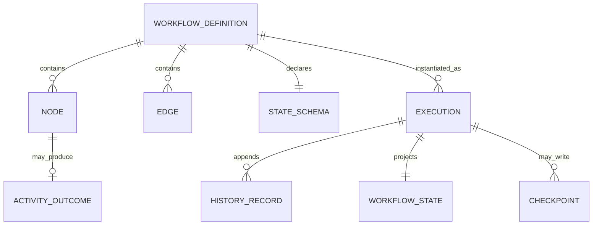

# 03 · Domain & Data

> **Authority:** Architecture. **AI policy:** agents propose updates via PR (`workflows/sync.md`, `workflows/review.md`).
> **Source-of-truth split:** schema and history-store implementations are the technical truth for *actual* shapes. This document describes the *intended* domain model. When they disagree, that is drift: either fix the code or record a deviation.
>
> **Sources:** [docs/architecture/arc42/12-glossary.md](../docs/architecture/arc42/12-glossary.md), [docs/engine-profile.md](../docs/engine-profile.md), [docs/RFC/rfc-03-workflow-definition-schema.md](../docs/RFC/rfc-03-workflow-definition-schema.md), [docs/RFC/rfc-04-execution-model.md](../docs/RFC/rfc-04-execution-model.md), [schemas/workflow-definition.json](../schemas/workflow-definition.json), `packages/engine/src/persistence/`.

## Ubiquitous language

| Term | Definition | Avoid |
|---|---|---|
| Agent Workflow Protocol | Spec family under `docs/RFC/` for declarative agent workflows | "the LangGraph protocol", informal "agent OS" |
| Engine profile | Authoritative runtime subset in `docs/engine-profile.md` | Treating full RFC silence as implemented behaviour |
| Workflow definition | Canonical JSON document (nodes, edges, state_schema) validated by the schema bundle | "script", "prompt chain" as the definition |
| Execution | One orchestration run keyed by `executionId` | "session" (unless host-specific) |
| Node | Typed graph vertex (`start`, `tool_call`, `interrupt`, …) | "step" for every node kind (`step` is one type) |
| Activity | Non-deterministic or external work whose result is recorded in history | Mixing into pure orchestration decisions |
| Command / Event | Append-only history records driving deterministic replay | Mutable "current state only" without history |
| Application port | `createWorkflowApplicationPort` façade over start/status/resume/submit | Calling walker internals from adapters |
| Host-mediated execution | Engine awaits; host completes activity and submits outcome | Assuming all tools run in-process |
| Engine-direct execution | In-process MCP tool invocation via operator manifest | Assuming every deploy uses it |
| History store | Memory or SQLite append-only persistence | "database of workflows" (definitions ≠ history) |
| Conformance vector | JSON case under `conformance/vectors/**` (`schema` or `replay`) | Ad-hoc manual checks as the gate |
| Reducer | `overwrite` / `append` / `merge` policy when merging node output into state | `custom` reducers (rejected in profile) |

## Domain model

## Entities

### Workflow definition

- **Meaning:** Portable, versioned plan for agent orchestration
- **Identity:** `document.name` + `document.version` (+ schema URI); content hash (`definitionHash`) binds checkpoints
- **Lifecycle:** authored → validated → executed (immutable for a given execution binding)
- **Invariants:** Profile node types only; no root `extensions`; edges form a valid graph for the profile
- **Table(s):** Not an ORM table — file/registry artifacts (`schemas/`, `examples/`, optional URI registry for `subworkflow`)

### Node

- **Meaning:** One graph unit of control or activity
- **Identity:** `id` within a definition
- **Lifecycle:** pending → (awaiting activity / waiting / interrupted) → completed | failed per execution
- **Invariants:** `type` in profile enum; retry/timeout shapes per RFC-03 §3.8 when present
- **Table(s):** Embedded in definition JSON

### Execution

- **Meaning:** A single run of a definition
- **Identity:** `executionId`
- **Lifecycle:** started → running / awaiting_activity / interrupted / waiting → completed | failed | cancelled
- **Invariants:** History is append-only; resume/submit verify definition binding
- **Table(s):** History store keyed by execution id (`MemoryExecutionHistoryStore`, `SqliteExecutionHistoryStore`)

### History record (Command / Event)

- **Meaning:** Ordered facts for replay
- **Identity:** Position in append-only log per execution
- **Lifecycle:** appended; never rewritten *(inferred from event-sourced model)*
- **Invariants:** Replay of prefix yields same next orchestration decisions
- **Table(s):** SQLite history implementation under `packages/engine/src/persistence/` — see code, do not duplicate columns here

### Workflow state

- **Meaning:** Projection of reducer-applied node outputs, validated against `state_schema`
- **Identity:** Per execution
- **Lifecycle:** Updated at node completion boundaries
- **Invariants:** Reducers limited to overwrite/append/merge
- **Table(s):** Projected; not a separate product database

## Data ownership & access

| Data | Owner | Read | Write | Enforced by |
|---|---|---|---|---|
| Workflow definition (in request) | Caller / host | Host, engine (validate) | Author systems outside engine | AJV + profile validation |
| Execution history | Engine process / operator deploy | Scoped `read_history` when auth configured | Engine append only | History store + optional Bearer scopes ([ADR-0005](../docs/architecture/adr/ADR-0005-mcp-control-plane-auth.md)) |
| Secrets in payloads | Operator | Redacted views | Injected via `secret_ref` / env — never committed | `RedactingExecutionHistoryStore`, secret_ref resolver |
| Operator MCP manifest | Operator | Process owner | Operator config files / env | Manifest allowlists ([docs/security/engine-direct-manifest-policy.md](../docs/security/engine-direct-manifest-policy.md)) |

## Data lifecycle & retention

- In-memory store: process lifetime only
- SQLite store: file retention is an **operator** concern; R5 calls out DR/backup runbooks *(seen: ROADMAP.md)* — no product-default cloud retention policy in-repo
- Definition signing keys and auth tokens: operator-managed; never commit *(seen: security baseline)*

## Migration conventions

- **No traditional DB migrations** for a product schema. Contract evolution is:
  - JSON Schema + `docs/engine-profile.md` + fixtures updated together
  - History **record versioning** documented in [docs/persistence-history-record-versioning.md](../docs/persistence-history-record-versioning.md)
  - Alpha→GA notes in [docs/migration-alpha-to-ga.md](../docs/migration-alpha-to-ga.md)
- Location for schema SSOT: `schemas/workflow-definition.json` (synced into `packages/engine/schemas/` on prepack)
