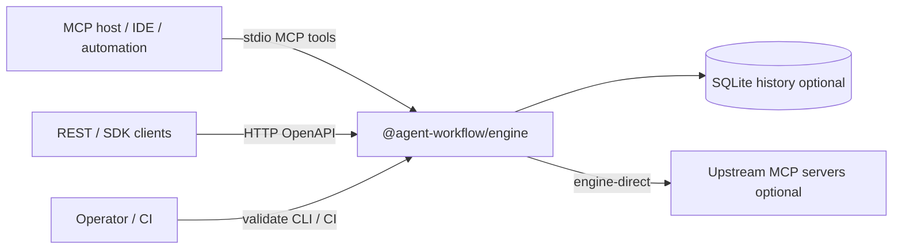

# 04 · Architecture & Technology

> **Authority:** Architecture. **AI policy:** agents propose updates via PR (`workflows/sync.md`, `workflows/review.md`). Significant decisions get an ADR — **in this repo, ADRs already live at [`docs/architecture/adr/`](../docs/architecture/adr/)** (not duplicated into `blueprint/decisions/` in this migration).
> **Changes when:** structure, boundaries, technology or cross-cutting concerns change.
>
> **Normative SSOT (link, don't copy):** [docs/RFC/](../docs/RFC/), [docs/engine-profile.md](../docs/engine-profile.md), [schemas/](../schemas/), [docs/architecture/arc42/](../docs/architecture/arc42/).

## System context

*(Seen: [arc42 §3](../docs/architecture/arc42/03-context-and-scope.md); diagram also in `docs/architecture/arc42-assets/diagrams/as-built-views.drawio`.)*

## Technology stack

| Layer | Choice | ADR / note |
|---|---|---|
| Language / runtime | Node.js ≥ 22.5.0 (CI: Node 24), ESM | ADR-0001 foundation |
| Reference engine | `@agent-workflow/engine@1.0.0` (`packages/engine/`) | Profile in `docs/engine-profile.md` |
| Client SDK | `@agent-workflow/sdk@1.0.0` (`packages/sdk/`) | REST + in-process port |
| Schema | JSON Schema Draft 2020-12 (`schemas/workflow-definition.json`) | Synced to package on prepack |
| Validation | AJV | — |
| Expressions | jq via `jq-wasm` (documented subset) | [docs/jq-conformance-subset.md](../docs/jq-conformance-subset.md) |
| Persistence | In-memory or SQLite (`node:sqlite`) history store | — |
| MCP | `@modelcontextprotocol/sdk` stdio adapter | ADR-0002 / ADR-0003 |
| REST | `workflows-engine-rest` + OpenAPI | — |
| Docs site | MkDocs (`website/`) → GitHub Pages | Publishing; not product UI |
| Testing | Node built-in test runner; conformance harness | — |
| CI | GitHub Actions (validate, conformance, CodeQL, release) | [docs/governance/](../docs/governance/) |

## Module structure & boundaries

| Module | Path | May depend on | Must not depend on |
|---|---|---|---|
| Contract artifacts | `docs/RFC/`, `docs/engine-profile.md`, `schemas/` | — | Runtime packages for normative text |
| Engine validation | `packages/engine/src/validate.mjs`, bundled schemas | schema JSON | Adapters |
| Application port | `packages/engine/src/application/` | orchestrator, persistence | MCP/REST transport details |
| Graph / linear orchestrator | `packages/engine/src/orchestrator/` | persistence, activity executors | MCP stdio framing |
| Persistence | `packages/engine/src/persistence/` | — | Adapters, docs site |
| MCP adapter | `packages/engine/src/adapters/mcp/`, `mcp-stdio-server.mjs` | application port | Direct walker calls *(intent)* |
| REST adapter | `packages/engine/src/rest-server.mjs`, `openapi/` | application port | — |
| SDK | `packages/sdk/` | engine package | Engine internals beyond public API |
| Conformance | `conformance/` | engine public API | Website |
| Repo scripts | `scripts/` | engine / schema | — |
| User docs / site | `docs/user/`, `website/` | built from docs pipeline | Engine runtime |

Logical layers *(seen: arc42 §3.5)*: Contract → Execution core → Persistence boundary → Integration adapters → Quality gates.

## Cross-cutting concerns

- **Authentication & authorisation:** Optional scoped Bearer tokens (`start`, `resume`, `read_history`, `submit_activity`); MCP stdio relies on OS process isolation — [docs/security/mcp-control-plane-auth.md](../docs/security/mcp-control-plane-auth.md), ADR-0005
- **Error handling & logging:** Stable structured error codes at adapters; secret redaction on persisted events
- **Configuration & secrets:** Env/manifest names only (`WORKFLOW_ENGINE_*`); never commit values — [docs/security/secret-ref-operator-config.md](../docs/security/secret-ref-operator-config.md)
- **Performance budgets:** No hard product SLOs yet; R5 targets throughput/latency *(seen: ROADMAP)*

## Security baseline

Link, don't paste: [docs/security/alpha-security-baseline.md](../docs/security/alpha-security-baseline.md), [SECURITY.md](../SECURITY.md), gap register and threat-model checklist under `docs/security/`. Highlights: AJV before port, payload size caps, redacting history store, definition signing (JWS Ed25519), command allowlists for engine-direct, Dependabot + CodeQL in CI.

## Architecture decision log

ADRs remain in **`docs/architecture/adr/`** (index: [docs/architecture/adr/README.md](../docs/architecture/adr/README.md)). Do not duplicate into `blueprint/decisions/` until a later migration decides to.

| ADR | Title | Status |
|---|---|---|
| [ADR-0001](../docs/architecture/adr/ADR-0001-poc-foundation-decisions.md) | POC foundation decisions | Accepted (amended; runtime truth = engine-profile) |
| [ADR-0002](../docs/architecture/adr/ADR-0002-host-mediated-activity-execution.md) | Host-mediated activity execution | Accepted |
| [ADR-0003](../docs/architecture/adr/ADR-0003-engine-direct-mcp-activity-execution.md) | Engine-direct MCP activity execution | Accepted |
| [ADR-0004](../docs/architecture/adr/ADR-0004-r3-delegation-and-subworkflow.md) | R3 delegation and subworkflow | Accepted |
| [ADR-0005](../docs/architecture/adr/ADR-0005-mcp-control-plane-auth.md) | MCP control-plane auth | Accepted |
